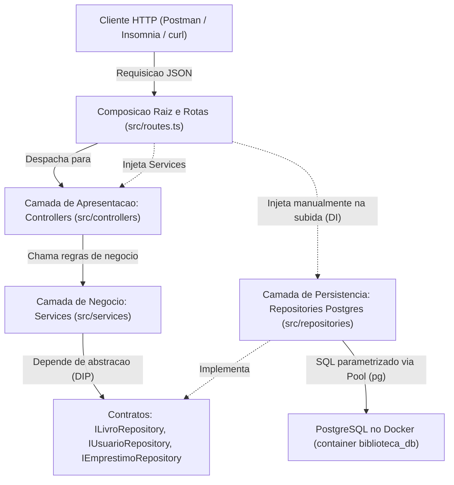
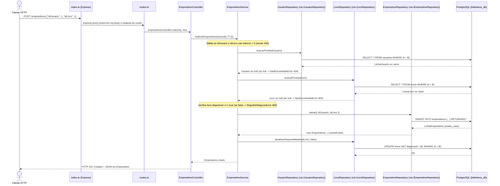
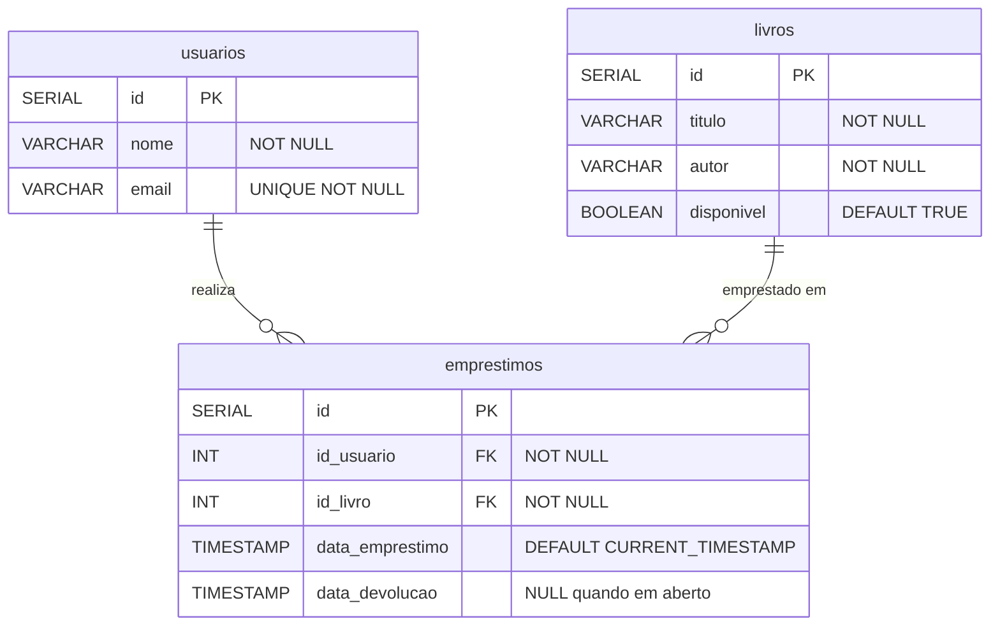

# Tutorial Completo: Sistema de Biblioteca (Monolito em Camadas Fechadas + DIP)

Este tutorial explica, passo a passo, **como o projeto foi construído**, **como cada arquivo e camada se comunica**, **por que cada decisão técnica foi tomada** e **como executar e validar toda a API** — pensado tanto para um estudante entendendo Arquitetura de Software na prática quanto para a avaliação acadêmica de um professor da disciplina.

---

## 1. Visão Geral do Projeto

O sistema é uma **API REST de Gerenciamento de Biblioteca** construída como um **Monolito em Camadas Fechadas** em **TypeScript + Node.js + Express + PostgreSQL**, aplicando o **Princípio da Inversão de Dependência (DIP)** e **Injeção Manual de Dependências (DI)**.

Escopo funcional do sistema:
- **1 aplicação monolítica** (`biblioteca_api`) conectada a **1 banco relacional** (`biblioteca_db` em container separado);
- **3 entidades de domínio**: `Usuario`, `Livro` e `Emprestimo`;
- **5 rotas HTTP**:
  1. `POST /usuarios` — cadastra um usuário leitor;
  2. `POST /livros` — cadastra um livro no acervo;
  3. `GET /livros` — lista todos os livros e indica se estão disponíveis;
  4. `POST /emprestimos` — registra o empréstimo de um livro disponível para um usuário;
  5. `GET /emprestimos` — lista todos os empréstimos realizados.

---

## 2. Tecnologias Utilizadas e o "Porquê" de Cada Uma

| Tecnologia / Biblioteca | Versão | Papel na Arquitetura | Por que foi escolhida |
| :--- | :--- | :--- | :--- |
| **Node.js (LTS)** | `24` (`node:24-alpine`) | Runtime JavaScript do servidor | Versão LTS ativa e mantida; substitui o Node 18 do guia original que já atingiu o fim de suporte (EOL). |
| **Express** | `^5.3.0` | Camada de Apresentação (`src/controllers`, `src/routes.ts`, `src/index.ts`) | Framework HTTP minimalista e didático para roteamento, `express.json()` e manipulação de `Request`/`Response`. |
| **pg (node-postgres)** | `^8.23.1` | Camada de Persistência (`src/repositories`) | Driver oficial PostgreSQL com suporte a `Pool` de conexões e queries parametrizadas (`$1, $2...`) contra SQL injection. |
| **TypeScript** | `^7.0.2` | Verificação estática de tipos (`npm run typecheck`) | Garante contratos rígidos (interfaces DIP, entidades, `strict: true`) sem necessidade de gerar arquivos `.js` em disco (`noEmit: true`). |
| **tsx** | `^4.23.15` | Executor TypeScript em desenvolvimento (`npm run dev`) | Substitui o antigo `ts-node-dev` (sem manutenção). Necessário mesmo no Node 24 porque o Node nativo não suporta *parameter properties* (`constructor(public id: number...)`). |
| **@types/node, @types/express, @types/pg** | `^24` / `^5` / `^8` | Tipagens de desenvolvimento | Fornecem autocompletar e checagem de tipos do Express, `pg` e variáveis de ambiente (`process.env`). |
| **Docker & Docker Compose** | Compose v2+ | Infraestrutura e orquestração | Isola a API (`biblioteca_api`) e o PostgreSQL (`biblioteca_db`) em containers separados e reproduzíveis. |
| **PostgreSQL** | `15-alpine` | Banco de dados relacional | SGBD robusto, leve em Alpine e com inicialização automática via `init.sql`. |

---

## 3. Guia PDF vs. Implementação Final (Decisões e Desvios Justificados)

O projeto seguiu fielmente a arquitetura e o código-base do documento guia, aplicando melhorias pontuais de engenharia moderna, segurança de tipos e compatibilidade com o ambiente local:

| # | O que o PDF sugeria | O que implementamos | Por que fizemos essa adaptação |
| :--- | :--- | :--- | :--- |
| **1** | `FROM node:18-alpine` | `FROM node:24-alpine` | O Node 18 entrou em *End-of-Life* (EOL). Adotamos o Node 24 LTS para usar apenas dependências ativamente mantidas. |
| **2** | `ts-node-dev` | `tsx` (`tsx watch src/index.ts`) | `ts-node-dev` não recebe mais manutenção. O `tsx` é moderno, rápido e suporta *parameter properties* do TypeScript (ao contrário do strip-types nativo do Node 24). |
| **3** | Gerar `tsconfig.json` via `npx tsc --init` | `tsconfig.json` escrito e comentado manualmente | No TypeScript 7, o `tsc --init` habilita `verbatimModuleSyntax` e configurações que quebram imports CommonJS. Configuramos `module: "nodenext"`, `types: ["node"]` e `noEmit: true`. |
| **4** | `version: '3.8'` no `docker-compose.yml` | Sem a chave `version` | A chave `version` é obsoleta no Docker Compose moderno (v2+/v5) e gera aviso no terminal. |
| **5** | Porta `"5432:5432"` no `docker-compose.yml` | `"${DB_HOST_PORT:-5434}:5432"` (padrão `5434` no host; `5432` interna) | Na máquina de desenvolvimento, a porta `5432` já está ocupada por um Postgres local e a `5433` por outro container (`postgres_padrao`). Tornar configurável via `DB_HOST_PORT` resolve conflitos sem mexer na rede interna `db:5432`. |
| **6** | `depends_on: - db` simples | `healthcheck` TCP no `db` (`pg_isready -h 127.0.0.1`) + `condition: service_healthy` | Evita que a API tente conectar antes de o PostgreSQL finalizar o `init.sql` e abrir a porta TCP real. |
| **7** | `postgres:15-alpine` | Mantido `postgres:15-alpine` | Versão ainda oficialmente suportada, leve e alinhada ao guia. |
| **8** | `id_usuario INT` e `id_livro INT` sem `NOT NULL` | Adicionado `NOT NULL` nas FKs de `emprestimos` | Impede no nível do banco a existência de um empréstimo órfão sem usuário ou sem livro. |
| **9** | `throw new Error(...)` com `catch (error: any)` | `RegraDeNegocioError` (→400) e `NaoEncontradoError` (→404) + `tratarErro(erro: unknown)` | O Service não deve conhecer HTTP, mas precisa distinguir erro de validação (400) de recurso inexistente (404) e erro inesperado (500), mantendo tipagem estrita sem `any`. |
| **10** | 5 rotas + devolução mencionada apenas na arguição | Exatamente as 5 rotas implementadas; devolução mantida para a arguição | Cumpre exatamente o tamanho definido no guia (`1 app, 3 entidades, 5 rotas`) e preserva a pergunta clássica de extensão da arguição. |

---

## 4. Estrutura de Pastas do Projeto

```text
projeto-final/
├── .dockerignore                          # Impede copiar node_modules do macOS e .git para o container Linux
├── .gitignore                             # Impede versionar node_modules, dist, .env e logs no Git
├── Dockerfile                             # Receita da imagem da API (Node 24 Alpine + npm install + npm run dev)
├── README.md                              # Visão resumida e links rápidos para documentação e execução
├── docker-compose.yml                     # Orquestra os containers biblioteca_db e biblioteca_api
├── init.sql                               # DDL PostgreSQL que cria as tabelas usuarios, livros e emprestimos
├── package.json                           # Scripts, dependências (express, pg, tsx, typescript) e comentários "//"
├── package-lock.json                      # Trava determinística das versões instaladas
├── tsconfig.json                          # Configuração estrita do verificador de tipos TypeScript (JSONC)
├── docs/
│   ├── TUTORIAL.md                        # Este guia completo de arquitetura, código e execução
│   └── ROTEIRO_APRESENTACAO.md            # Roteiro de slides (20 min) e arguição com o professor
└── src/
    ├── index.ts                           # Inicialização do servidor Express na porta 3000
    ├── routes.ts                          # Composição raiz (DI manual) e registro das 5 rotas HTTP
    ├── entities/                          # CAMADA DE DOMÍNIO (sem dependências externas)
    │   ├── Emprestimo.ts
    │   ├── Livro.ts
    │   └── Usuario.ts
    ├── interfaces/                        # CONTRATOS DIP / ISP (importam apenas Entities)
    │   ├── IEmprestimoRepository.ts
    │   ├── ILivroRepository.ts
    │   └── IUsuarioRepository.ts
    ├── repositories/                      # CAMADA DE PERSISTÊNCIA (importam Interfaces, Entities e pg)
    │   ├── EmprestimoRepository.ts
    │   ├── LivroRepository.ts
    │   ├── PostgresDb.ts
    │   └── UsuarioRepository.ts
    ├── services/                          # CAMADA DE NEGÓCIO (importam apenas Interfaces, Entities e Errors)
    │   ├── EmprestimoService.ts
    │   ├── LivroService.ts
    │   ├── UsuarioService.ts
    │   └── errors/
    │       ├── NaoEncontradoError.ts
    │       └── RegraDeNegocioError.ts
    └── controllers/                       # CAMADA DE APRESENTAÇÃO (importam Express, Services e Errors)
        ├── EmprestimoController.ts
        ├── LivroController.ts
        ├── UsuarioController.ts
        └── tratarErro.ts
```

---

## 5. Diagrama de Arquitetura (Monolito em Camadas Fechadas + DIP)

O fluxo de execução atravessa as camadas **exclusivamente de cima para baixo**. Nenhuma camada pula a intermediária, e a camada de negócio aponta apenas para interfaces (Inversão de Dependência):



---

## 6. Regra das Camadas Fechadas: Quem Pode Importar Quem?

Em uma arquitetura de **camadas fechadas**, uma camada só conhece a camada imediatamente abaixo (ou contratos/entidades compartilhadas pelo domínio). O arquivo `src/routes.ts` atua como a **Composição Raiz** (*Composition Root*) fora das camadas de domínio para conectar as implementações concretas na inicialização.

| Origem (Quem importa) | Pode importar | Proibido importar |
| :--- | :--- | :--- |
| **`src/entities/`** | Nada (TypeScript puro) | `express`, `pg`, `interfaces`, `repositories`, `services`, `controllers` |
| **`src/interfaces/`** | `entities` | `express`, `pg`, `repositories`, `services`, `controllers` |
| **`src/services/`** | `interfaces`, `entities`, `services/errors` | **`repositories`**, **`pg`**, **`express`**, `controllers` |
| **`src/repositories/`** | `interfaces`, `entities`, `pg` (`PostgresDb.ts`) | `express`, `services`, `controllers` |
| **`src/controllers/`** | `express` (Request/Response), `services`, `services/errors`, `tratarErro` | **`repositories`**, **`pg`** |
| **`src/routes.ts`** | `express`, `controllers`, `services`, `repositories` | *(Composição Raiz: único arquivo que conecta tudo)* |
| **`src/index.ts`** | `express`, `routes` | `repositories`, `services`, `controllers` |

Você pode auditar o isolamento das camadas fechadas a qualquer momento com os comandos:

```bash
grep -rn "repositories" src/controllers src/services
grep -rn "from 'pg'" src --include='*.ts' | grep -v src/repositories
grep -rn "express" src/services src/repositories src/entities src/interfaces
grep -rn "controllers\|services" src/repositories src/interfaces src/entities
```

Todos os quatro comandos devem retornar **vazio** (nenhuma violação).

---

## 7. DIP e Injeção de Dependência na Prática

O **Princípio da Inversão de Dependência (DIP — letra D do SOLID)** afirma que módulos de alto nível (regras de negócio) não devem depender de módulos de baixo nível (PostgreSQL); **ambos devem depender de abstrações (interfaces)**. Também aplicamos o **ISP (Segregação de Interfaces)**: cada interface declara apenas os métodos que os serviços realmente usam.

1. **A abstração (`src/interfaces/ILivroRepository.ts`)**:
   ```ts
   export interface ILivroRepository {
     salvar(livro: Omit<Livro, 'id'>): Promise<Livro>;
     buscarTodos(): Promise<Livro[]>;
     buscarPorId(id: number): Promise<Livro | null>;
     atualizarDisponibilidade(id: number, disponivel: boolean): Promise<void>;
   }
   ```

2. **O Serviço depende apenas da interface (`src/services/LivroService.ts`)**:
   ```ts
   export class LivroService {
     constructor(private livroRepository: ILivroRepository) {}
   }
   ```
   Repare que `LivroService` não sabe se os dados vêm do PostgreSQL, do MongoDB ou de qualquer outra fonte de persistência.

3. **O Repositório implementa o contrato (`src/repositories/LivroRepository.ts`)**:
   ```ts
   export class LivroRepository implements ILivroRepository { ... }
   ```

4. **A Injeção Manual ocorre na Composição Raiz (`src/routes.ts`)**:
   ```ts
   const livroRepo = new LivroRepository();
   const livroService = new LivroService(livroRepo);
   const livroController = new LivroController(livroService);
   ```

---

## 8. Fluxo de Comunicação: Sequência Completa de `POST /emprestimos`

O diagrama abaixo mostra o caminho real de uma requisição de empréstimo através de todos os arquivos da arquitetura:



Se qualquer erro ocorrer no `Service`, o `EmprestimoController` entra no `catch (erro: unknown)` e chama `tratarErro(erro, res)`:
- `NaoEncontradoError` → **HTTP 404** `{ "erro": "..." }`
- `RegraDeNegocioError` → **HTTP 400** `{ "erro": "..." }`
- Qualquer outro erro inesperado → registra `console.error` e retorna **HTTP 500** `{ "erro": "Erro interno do servidor." }`

---

## 9. Modelo Relacional do Banco de Dados (`init.sql`)



---

## 10. Guia Arquivo por Arquivo

- **`package.json`**: Define scripts (`dev`, `typecheck`), dependências (`express`, `pg`, `typescript`, `tsx`, `@types/*`) e documenta tudo na chave `"//"`.
- **`tsconfig.json`**: Configura TypeScript estrito (`strict: true`, `module: "nodenext"`, `types: ["node"]`, `noEmit: true`) cobrindo `src/`.
- **`.gitignore` / `.dockerignore`**: Mantêm `node_modules` fora do Git e impedem que binários compilados para macOS (como o `esbuild` do `tsx`) entrem na imagem Linux Alpine.
- **`Dockerfile`**: Usa `node:24-alpine`, instala dependências dentro do Linux e inicia com `npm run dev`.
- **`docker-compose.yml`**: Sobe `biblioteca_db` (Postgres 15 com `init.sql` e `healthcheck` TCP) e `biblioteca_api` (`depends_on: service_healthy`), mapeando `${DB_HOST_PORT:-5434}:5432` para o host.
- **`init.sql`**: Script DDL que cria `usuarios`, `livros` e `emprestimos`.
- **`src/entities/*.ts`**: Classes puras `Livro`, `Usuario` e `Emprestimo` usando *parameter properties*.
- **`src/interfaces/*.ts`**: Contratos `ILivroRepository`, `IUsuarioRepository` e `IEmprestimoRepository` usados pelos Services e implementados pelos repositórios PostgreSQL.
- **`src/repositories/PostgresDb.ts`**: Instancia o `Pool` do `pg` lendo variáveis de ambiente (com fallback `localhost` e porta `'5434'` para rodar fora do Docker).
- **`src/repositories/*Repository.ts`**: Executam SQL parametrizado (`$1`, `$2...`), ordenam listagens com `ORDER BY id` e convertem linhas `snake_case` do banco em entidades `camelCase` via método privado `paraEntidade`.
- **`src/services/errors/*.ts`**: Hierarquia de erros de negócio (`RegraDeNegocioError` e `NaoEncontradoError`) desacoplada do Express.
- **`src/services/*.ts`**: Contêm todas as regras de validação (campos obrigatórios, formato/unicidade de e-mail em minúsculas, IDs inteiros positivos, existência de usuário/livro, checagem de disponibilidade e atualização após empréstimo).
- **`src/controllers/tratarErro.ts` e `*Controller.ts`**: Recebem `req`/`res`, usam fallback `req.body ?? {}` (necessário no Express 5), delegam ao Service e formatam respostas JSON (200/201/400/404/500).
- **`src/routes.ts`**: Instancia repositórios, services e controllers manualmente e registra as 5 rotas HTTP.
- **`src/index.ts`**: Cria o app Express, aplica `express.json()` e `router`, e escuta na porta `3000`.

---

## 11. Histórico de Commits Construído Passo a Passo

Cada etapa da construção foi registrada em um commit atômico e enviada ao GitHub (`git push`):

| Ordem | Hash | Mensagem do Commit | O que foi construído |
| :--- | :--- | :--- | :--- |
| 0 | `fab336c` | `first commit` | Inicialização do repositório e `README.md` |
| 1 | `44e3d61` | `chore: setup inicial do projeto node com typescript` | `package.json`, `package-lock.json`, `tsconfig.json`, `.gitignore` |
| 2 | `ac4f1cb` | `chore: configuracao do docker e docker-compose` | `Dockerfile`, `.dockerignore`, `docker-compose.yml` |
| 3 | `65f51b1` | `feat: script de banco de dados postgresql` | `init.sql` com as 3 tabelas e FKs `NOT NULL` |
| 4 | `1d7d3a4` | `feat: classes de entidades do dominio` | `Livro.ts`, `Usuario.ts`, `Emprestimo.ts` |
| 5 | `fa13535` | `feat: criacao das interfaces para o DIP` | `ILivroRepository.ts`, `IUsuarioRepository.ts`, `IEmprestimoRepository.ts` |
| 6 | `25e4f06` | `feat: conexao com o postgresql via pool` | `PostgresDb.ts` com `Pool` configurável por ambiente |
| 7 | `3c1df02` | `feat: implementacao dos repositorios do postgres` | `LivroRepository.ts`, `UsuarioRepository.ts`, `EmprestimoRepository.ts` |
| 8 | `e104440` | `feat: implementacao da camada de servicos com injecao de dependencia` | `RegraDeNegocioError`, `NaoEncontradoError` e os 3 Services |
| 9 | `1abb828` | `feat: controllers da camada de apresentacao` | `tratarErro.ts` e os 3 Controllers |
| 10 *(fix)* | `4ed7977` | `fix: porta externa do postgres configuravel com padrao 5434` | Resolução real de conflito de porta no host (5432 local e 5433 outro container) usando `${DB_HOST_PORT:-5434}:5432` |
| 11 | `bffefb5` | `feat: finalizacao da api com rotas, injecao manual e servidor` | `src/routes.ts` (DI manual + 5 rotas) e `src/index.ts` |
| 12 | `3329020` | `test: testes unitarios dos servicos com repositorios em memoria` | Adição temporária de suíte unitária (removida posteriormente no commit `73ab423`) |
| 13 | `bba8c30` | `chore: script de demonstracao da api com curl` | Script auxiliar de demonstração (removido posteriormente no commit `73ab423`) |
| 14 | `abea4e1` | `docs: tutorial completo de construcao, comunicacao e execucao` | Primeira versão de `docs/TUTORIAL.md` e atualização do `README.md` |
| 15 | `284b474` | `docs: roteiro de apresentacao em slides` | Primeira versão de `docs/ROTEIRO_APRESENTACAO.md` |
| 16 | `73ab423` | `chore: remove testes unitarios, script demo e referencias em codigo` | Limpeza do projeto para manter apenas o código essencial da apresentação |
| 17 | *(este passo)* | `docs: atualiza documentacao e roteiro removendo itens nao essenciais` | Atualização do `README.md`, `docs/TUTORIAL.md` e `docs/ROTEIRO_APRESENTACAO.md` |

> **Nota didática sobre o commit `4ed7977` (`fix`)**: Ao subir os containers pela primeira vez, o Docker reportou `Bind for 0.0.0.0:5433 failed: port is already allocated`, pois a máquina já possuía um PostgreSQL local na porta `5432` e outro container do usuário (`postgres_padrao`) na `5433`. Alterar o mapeamento para `${DB_HOST_PORT:-5434}:5432` e atualizar o fallback em `PostgresDb.ts` para `'5434'` resolveu o conflito mantendo a rede interna `db:5432` intacta.

---

## 12. Como Rodar o Projeto

### Opção 1: Tudo no Docker (Recomendado para a apresentação)

1. Certifique-se de que o Docker (OrbStack ou Docker Desktop) está aberto e rodando.
2. Na raiz do projeto, execute:
   ```bash
   docker compose up --build
   ```
   *(Em uma máquina onde a porta `5433` esteja livre e você queira usá-la no host, basta rodar `DB_HOST_PORT=5433 docker compose up --build`.)*
3. Aguarde os logs exibirem:
   ```text
   biblioteca_api  | Servidor rodando na porta 3000
   ```
   O Postgres estará disponível para ferramentas externas (DBeaver/TablePlus) em `localhost:5434`, e a API em `http://localhost:3000`.

### Opção 2: Banco no Docker + API rodando localmente no terminal

Útil para desenvolvimento com *hot reload* direto na máquina:
```bash
docker compose up -d db
npm install
npm run dev
```
O `PostgresDb.ts` usará automaticamente `localhost:5434` para falar com o container `biblioteca_db`.

### Checagem de Tipos TypeScript

```bash
# Valida toda a tipagem estrita TypeScript em src/
npm run typecheck
```

---

## 13. Exemplos de Requisições para Postman / Insomnia / curl

Todas as rotas aceitam e retornam `Content-Type: application/json`.

### 1) Criar Usuário — `POST http://localhost:3000/usuarios`
- **Body (JSON)**:
  ```json
  {
    "nome": "Icaro Pereira",
    "email": "icaro@biblioteca.com"
  }
  ```
- **Resposta esperada (`201 Created`)**:
  ```json
  {
    "id": 1,
    "nome": "Icaro Pereira",
    "email": "icaro@biblioteca.com"
  }
  ```
- **Erros possíveis (`400 Bad Request`)**:
  - `{ "erro": "Nome e e-mail são obrigatórios." }`
  - `{ "erro": "E-mail inválido." }`
  - `{ "erro": "E-mail já cadastrado." }`

### 2) Cadastrar Livro — `POST http://localhost:3000/livros`
- **Body (JSON)**:
  ```json
  {
    "titulo": "Arquitetura Limpa",
    "autor": "Robert C. Martin"
  }
  ```
- **Resposta esperada (`201 Created`)**:
  ```json
  {
    "id": 1,
    "titulo": "Arquitetura Limpa",
    "autor": "Robert C. Martin",
    "disponivel": true
  }
  ```
- **Erro possível (`400 Bad Request`)**:
  - `{ "erro": "Título e autor são obrigatórios." }`

### 3) Listar Livros — `GET http://localhost:3000/livros`
- **Resposta esperada (`200 OK`)**:
  ```json
  [
    {
      "id": 1,
      "titulo": "Arquitetura Limpa",
      "autor": "Robert C. Martin",
      "disponivel": true
    }
  ]
  ```

### 4) Realizar Empréstimo — `POST http://localhost:3000/emprestimos`
- **Body (JSON)**:
  ```json
  {
    "idUsuario": 1,
    "idLivro": 1
  }
  ```
- **Resposta esperada (`201 Created`)**:
  ```json
  {
    "id": 1,
    "idUsuario": 1,
    "idLivro": 1,
    "dataEmprestimo": "2026-11-22T21:42:31.521Z",
    "dataDevolucao": null
  }
  ```
- **Erros possíveis**:
  - `400 Bad Request`: `{ "erro": "idUsuario e idLivro devem ser números inteiros positivos." }`
  - `404 Not Found`: `{ "erro": "Usuário não encontrado." }`
  - `404 Not Found`: `{ "erro": "Livro não encontrado." }`
  - `400 Bad Request`: `{ "erro": "Livro já está emprestado." }` *(ao tentar emprestar o mesmo livro novamente)*

### 5) Listar Empréstimos — `GET http://localhost:3000/emprestimos`
- **Resposta esperada (`200 OK`)**:
  ```json
  [
    {
      "id": 1,
      "idUsuario": 1,
      "idLivro": 1,
      "dataEmprestimo": "2026-11-22T21:42:31.521Z",
      "dataDevolucao": null
    }
  ]
  ```

---

## 14. Troubleshooting (Solução de Problemas Comuns)

1. **Erro `Cannot connect to the Docker daemon` / socket do OrbStack não encontrado**
   - Abra o OrbStack (`open -a OrbStack` no macOS) ou o Docker Desktop e aguarde alguns segundos antes de rodar `docker compose up --build`.
2. **Erro `Bind for 0.0.0.0:5434 failed: port is already allocated` (ou porta `3000` ocupada)**
   - Verifique o processo na porta com `lsof -nP -iTCP:5434 -sTCP:LISTEN` ou defina outra porta para o Postgres do host:
     ```bash
     DB_HOST_PORT=5435 docker compose up --build
     ```
3. **Alterei o `init.sql`, mas as tabelas novas/alteradas não apareceram no banco**
   - A imagem oficial do Postgres só executa arquivos em `/docker-entrypoint-initdb.d/` quando o volume de dados do banco está **vazio** na primeira inicialização.
   - Para recriar apenas os containers e volumes deste projeto do zero, rode na pasta do projeto:
     ```bash
     docker compose down -v
     docker compose up --build
     ```
4. **Erro de arquitetura nativa (`esbuild` / ELF header invalid) dentro do container**
   - Confirme que `node_modules` está listado no arquivo `.dockerignore` para impedir a cópia da pasta `node_modules` compilada no macOS para dentro do container Linux Alpine.

---

## 15. Limitações Conhecidas e Melhorias Futuras

- **Atomicidade de transação no empréstimo**: `EmprestimoService.realizarEmprestimo` executa `emprestimoRepository.salvar` e depois `livroRepository.atualizarDisponibilidade` em duas chamadas separadas, sem envolver ambas em uma transação SQL (`BEGIN ... COMMIT`). Em produção, um padrão *Unit of Work* ou método transacional garantiria atomicidade completa.
- **Rota de devolução de livros**: Propositalmente deixada fora das 5 rotas iniciais para cumprir o escopo do trabalho e servir de exercício de extensibilidade na arguição (`POST /emprestimos/:id/devolucao`).
- **Paginação e filtros**: As rotas `GET /livros` e `GET /emprestimos` retornam todos os registros ordenados por `id`; em acervos grandes, parâmetros `?page=` e `?limit=` seriam recomendados.
- **Testes automatizados futuros**: Como o projeto mantém apenas o código essencial para a apresentação, adicionar futuramente suítes unitárias (injetando implementações em memória nas interfaces DIP) e de integração HTTP aumentaria a cobertura contra regressões.
